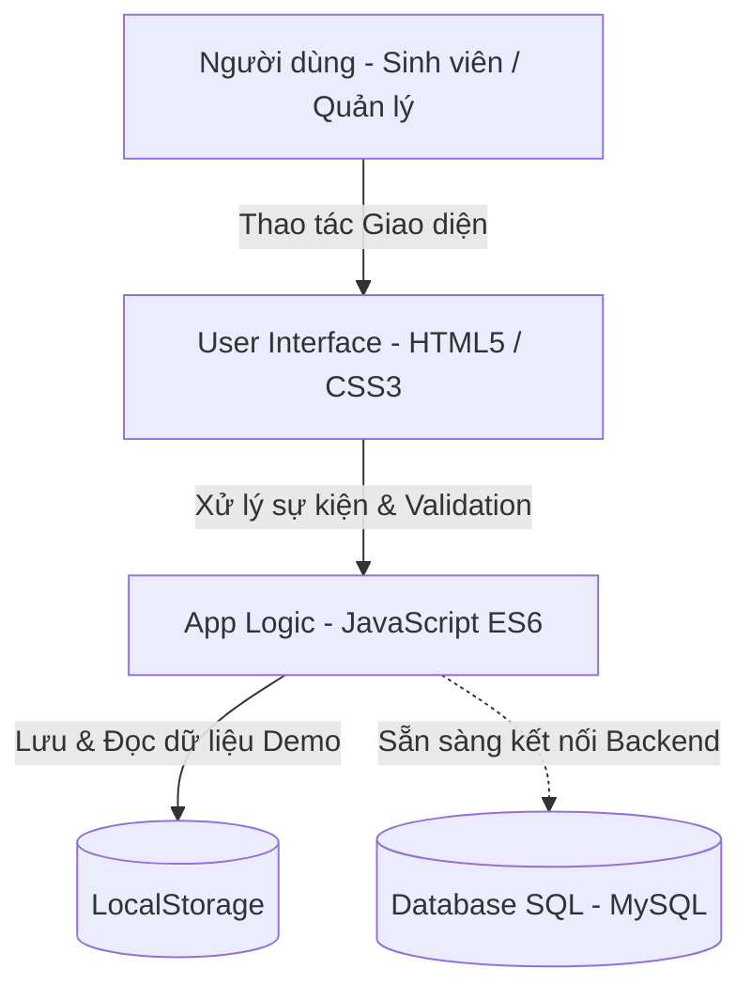
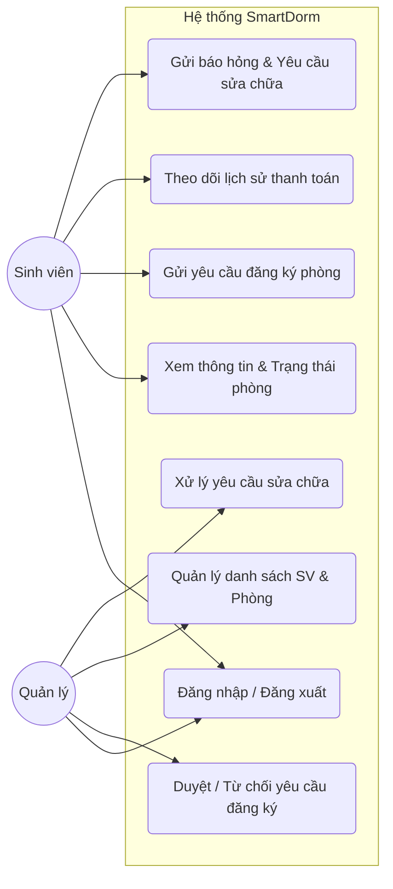
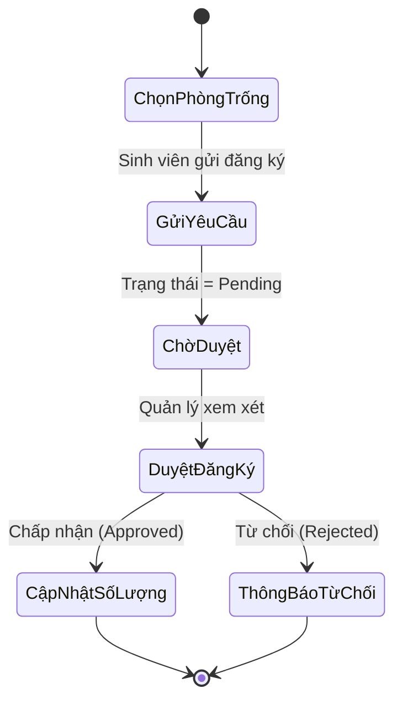
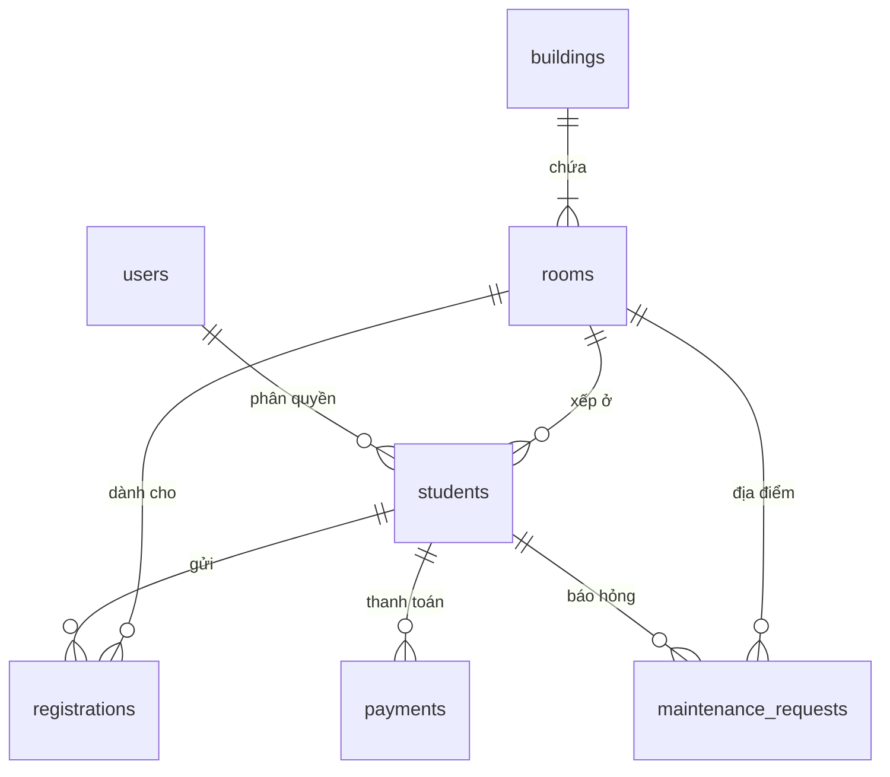

# SmartDorm - Hệ thống Quản lý Ký túc xá Sinh viên

**SmartDorm** là hệ thống phần mềm quản lý ký túc xá sinh viên hiện đại, hỗ trợ tự động hóa các quy trình quản lý thông tin sinh viên, phòng ở, đăng ký phòng, theo dõi thanh toán và xử lý sự cố thiết bị.

Đồ án thuộc môn **Kỹ Thuật phần mềm**.

---

## 👥 Thành viên thực hiện

| STT | Họ và tên | MSSV | Vai trò |
|:---:|---|:---:|---|
| 1 | **Hoàng Vũ** | 24100381 | Frontend, Database & Tài liệu |
| 2 | **Nguyễn Duy Anh** | 24100431 | Frontend, Luồng nghiệp vụ & Kiểm thử |

---

## 🛠 Công nghệ sử dụng

- **Frontend**: HTML5, CSS3, JavaScript (ES6)
- **Lưu trữ dữ liệu**: LocalStorage (Phiên bản Demo / Client-side)
- **Cơ sở dữ liệu**: MySQL (Thiết kế file `.sql` phục vụ kết nối Backend)
- **Quản lý mã nguồn**: Git, GitHub
- **Công cụ sơ đồ**: Mermaid.js, Markdown

---

## ✨ Chức năng chính

### 1. Đối với Sinh viên
- **Tra cứu & Đăng ký phòng**: Xem danh sách phòng còn trống, sức chứa, giá tiền và gửi yêu cầu đăng ký.
- **Quản lý cá nhân**: Xem thông tin tài khoản, thông tin phòng đang lưu trú.
- **Theo dõi thanh toán**: Tra cứu hóa đơn các tháng, số tiền, ngày thanh toán và trạng thái thanh toán.
- **Yêu cầu sửa chữa**: Gửi yêu cầu báo hỏng thiết bị (điện, nước, quạt, điều hòa, bóng đèn...) và theo dõi tiến độ xử lý.

### 2. Đối với Quản lý (Admin)
- **Quản lý phòng & Sinh viên**: Xem danh sách sinh viên, danh sách phòng, theo dõi trạng thái phòng (Trống / Gần đầy / Đã đầy).
- **Duyệt đăng ký**: Tiếp nhận, xem chi tiết và Duyệt / Từ chối các yêu cầu đăng ký phòng của sinh viên.
- **Quản lý sự cố**: Tiếp nhận báo hỏng thiết bị và cập nhật trạng thái xử lý.
- **Phân quyền & Tìm kiếm**: Quản lý truy cập theo vai trò (Student / Manager) và tìm kiếm thông tin nhanh chóng.

---

## 📊 Mô hình & Sơ đồ hệ thống

### 1. Kiến trúc hệ thống


### 2. Sơ đồ Use Case (Phân quyền người dùng)


### 3. Quy trình Đăng ký & Duyệt phòng (Activity Diagram)


### 4. Sơ đồ Quan hệ Thực thể (ERD)


---

## 🗄 Mô hình Cơ sở Dữ liệu

| Bảng (Table) | Các trường chính (Fields) | Mô tả |
|---|---|---|
| **users** | `id`, `username`, `password`, `role` | Tài khoản đăng nhập hệ thống |
| **students** | `id`, `student_code`, `full_name`, `email`, `phone`, `room_id` | Thông tin cá nhân sinh viên |
| **buildings** | `id`, `name`, `address` | Thông tin tòa nhà ký túc xá |
| **rooms** | `id`, `room_code`, `building_id`, `floor`, `capacity`, `current_count`, `price`, `status` | Quản lý thông tin & sức chứa phòng |
| **registrations** | `id`, `student_id`, `room_id`, `registration_date`, `status` | Đơn đăng ký ở ký túc xá |
| **payments** | `id`, `student_id`, `amount`, `payment_month`, `payment_date`, `status` | Hóa đơn & Lịch sử thanh toán |
| **maintenance_requests** | `id`, `student_id`, `room_id`, `title`, `description`, `status` | Báo hỏng & Yêu cầu sửa chữa |

---

## 🔑 Tài khoản Đăng nhập Demo

| Vai trò | Mã người dùng (Username) | Mật khẩu (Password) |
|---|:---:|:---:|
| **Sinh viên** | `student` | `123456` |
| **Quản lý** | `manager` | `123456` |

---

## 📂 Cấu trúc thư mục Dự án

```text
SmartDorm/
│
├── README.md               # Tài liệu hướng dẫn dự án
├── .gitignore              # Cấu hình bỏ qua file trong Git
│
├── src/                    # Mã nguồn ứng dụng Frontend
│   ├── index.html          # Trang giao diện chính
│   ├── css/
│   │   └── style.css       # File định dạng giao diện
│   └── js/
│       └── app.js          # Logic xử lý và quản lý LocalStorage
│
├── database/
│   └── smartdorm.sql       # Script khởi tạo CSDL MySQL
│
├── docs/                   # Tài liệu thiết kế
│   ├── requirements.md     # Yêu cầu bài toán
│   ├── database.md         # Mô tả chi tiết CSDL
│   └── uml.md              # Các sơ đồ thiết kế UML
│
├── tests/
│   └── test-cases.md       # Danh sách kịch bản kiểm thử
│
└── report/
    └── bao-cao.md          # Báo cáo tổng kết đồ án
```

---

## 🚀 Hướng dẫn Cài đặt & Chạy ứng dụng

### 1. Yêu cầu môi trường
- Hệ điều hành: Windows / macOS / Linux
- Trình duyệt web: Google Chrome / Microsoft Edge / Firefox
- Trình soạn thảo mã nguồn: Visual Studio Code

### 2. Các bước khởi chạy
1. **Clone repository về máy:**
   ```bash
   git clone https://github.com/VuHoang06/BTL_KTPM_Nhom12.git
   ```
2. **Di chuyển vào thư mục dự án:**
   ```bash
   cd SmartDorm
   ```
3. **Mở dự án trên VS Code:**
   ```bash
   code .
   ```
4. **Khởi chạy giao diện:**
   - Mở file `src/index.html` trực tiếp bằng trình duyệt, hoặc
   - Phải chuột vào `src/index.html` chọn **Open with Live Server**.

---

## 🧪 Kiểm thử (Test Cases)

Dự án được kiểm thử qua các kịch bản chính (`tests/test-cases.md`):
- [x] Đăng nhập / Đăng xuất & Kiểm tra phân quyền.
- [x] Tìm kiếm và lọc phòng trống theo trạng thái.
- [x] Gửi đơn đăng ký phòng & Kiểm tra ràng buộc dữ liệu.
- [x] Quản lý duyệt/từ chối đơn và tự động cập nhật `current_count` của phòng.
- [x] Gửi yêu cầu sửa chữa thiết bị & Xử lý trạng thái sự cố.
- [x] Tra cứu lịch sử thanh toán tiền phòng.

---

## 📈 Hướng phát triển tiếp theo

- **Backend Development**: Xây dựng RESTful API với Node.js (Express) hoặc Java (Spring Boot).
- **Xác thực bảo mật**: Áp dụng JWT Authentication & mã hóa mật khẩu (Bcrypt).
- **Tích hợp thanh toán**: Kết nối cổng thanh toán trực tuyến (VNPAY, MoMo).
- **Thông báo tự động**: Gửi Email/SMS nhắc lịch thanh toán & kết quả duyệt phòng.
- **Dashboard & Báo cáo**: Thống kê doanh thu, tỷ lệ lấp đầy phòng bằng biểu đồ tương tác.
